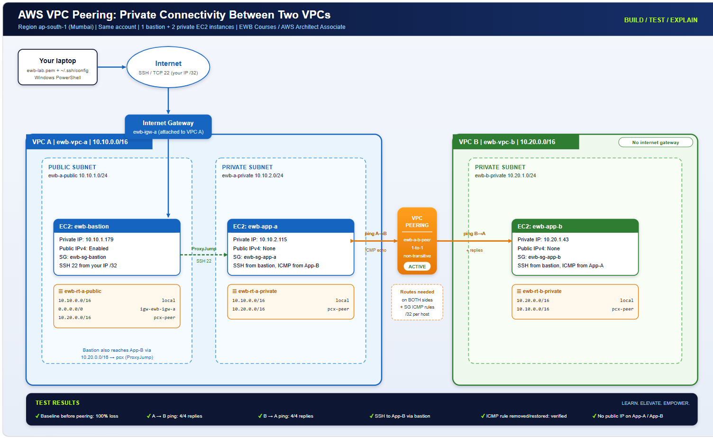

# AWS VPC Peering: Private Connectivity Between Two VPCs

Hands-on AWS networking project: two VPCs connected with VPC peering,
a public bastion host, and private EC2 instances reachable only over private IPs.

Student: Kakkireni Abhinav | Region: ap-south-1 (Mumbai) | Completed: 29/10/2026
Course: EWB Courses, AWS Architect Associate

## Architecture

## Objective
Connect two non-overlapping VPCs with peering so private instances can
exchange traffic using private IPv4 addresses, with a bastion host for admin access.

## Resources
| Resource | Name | CIDR / IP | ID |
|---|---|---|---|
| VPC A | ewb-vpc-a | 10.10.0.0/16 | vpc-xxxx |
| Public subnet | ewb-a-public | 10.10.1.0/24 | subnet-xxxx |
| Private subnet A | ewb-a-private | 10.10.2.0/24 | subnet-xxxx |
| VPC B | ewb-vpc-b | 10.20.0.0/16 | vpc-xxxx |
| Private subnet B | ewb-b-private | 10.20.1.0/24 | subnet-xxxx |
| Bastion | ewb-bastion | 10.10.1.179 + public IP | i-xxxx |
| App-A | ewb-app-a | 10.10.2.115 | i-xxxx |
| App-B | ewb-app-b | 10.20.1.43 | i-xxxx |
| Peering | ewb-a-b-peer | VPC A to VPC B | pcx-xxxx |

## Routing
| Route table | Destination | Target |
|---|---|---|
| ewb-rt-a-public | 0.0.0.0/0 | Internet gateway |
| ewb-rt-a-public | 10.20.0.0/16 | Peering connection |
| ewb-rt-a-private | 10.20.0.0/16 | Peering connection |
| ewb-rt-b-private | 10.10.0.0/16 | Peering connection |

## Security groups
| Group | Rule | Source |
|---|---|---|
| ewb-sg-bastion | SSH 22 | My IP /32 |
| ewb-sg-app-a | SSH 22 / ICMP echo | Bastion /32 / App-B /32 |
| ewb-sg-app-b | SSH 22 / ICMP echo | Bastion /32 / App-A /32 |

## Test results
| # | Test | Result | Evidence |
|---|---|---|---|
| 1 | Baseline ping before peering | 100% loss | [screenshot](screenshots/ssh_5.3.png) |
| 2 | App-A to App-B ping | 4/4 replies | [screenshot](screenshots/app-a_6.2.png) |
| 3 | App-B to App-A ping | 4/4 replies | [screenshot](screenshots/app-b_6.1.png) |
| 4 | SSH to App-B via bastion | Success | [screenshot](screenshots/app-b_6.1.png) |
| 5 | No public IP on private hosts | Confirmed | [screenshot](screenshots/Instance_4.1.png) |
| 6 | ICMP rule removed | Ping fails | [screenshot](screenshots/icmp_removed.png) |
| 7 | ICMP rule restored | Ping works | [screenshot](screenshots/icmp_restored.png) |

## How it works
**Forward path:** App-A sends to 10.20.1.43. Its route table sends 10.20.0.0/16
to the peering connection, and App-B's security group allows ICMP from App-A.
**Return path:** App-B's route table sends 10.10.0.0/16 back through the peering
connection. Routes are needed on both sides, and Active peering alone does not
allow traffic.

## Key learnings
- VPC CIDRs must not overlap.
- Peering is one-to-one and non-transitive.
- Route tables and security groups both control traffic.
- A bastion with ProxyJump avoids copying keys to servers.

## Cleanup
All resources were deleted after testing ([evidence](screenshots/13-cleanup.png)).

## Full report
[Download the PDF report](report/Kakkireni_Abhinav_EWB_VPC_Peering.pdf)
